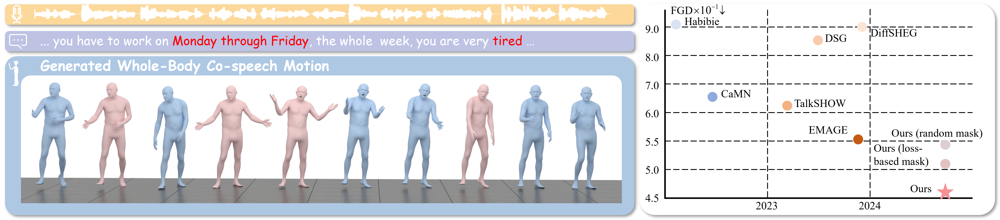
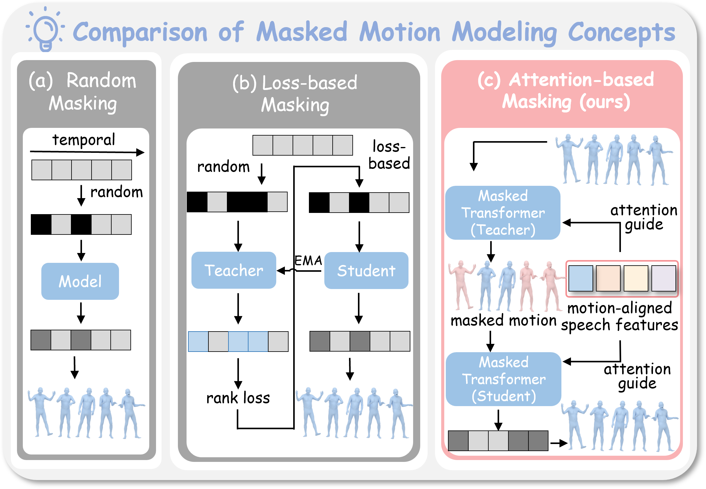

<div align="center">
<h2><font> </font></center> <br> <center>EchoMask: Speech-Queried Attention-based Mask Modeling for Holistic Co-Speech Motion Generation</h2>

[Xiangyue Zhang\*](https://xiangyue-zhang.github.io/), [Jianfang Li\*](https://github.com/Xiangyue-Zhang/EchoMask), [Jiaxu Zhang](https://kebii.github.io/), [Jianqiang Ren](https://github.com/JianqiangRen), [Liefeng Bo](https://scholar.google.com/citations?user=FJwtMf0AAAAJ&hl=en), [Zhigang Tu†](http://tuzhigang.cn/)
<p align="center">
  <strong>✨ACM MM 2025✨</strong>
</p>
<a href='https://arxiv.org/abs/2504.09209'></a> <a href='https://huggingface.co/papers/2504.09209'></a> <a href='https://xiangyuezhang.com/EchoMask/'></a> <a href='https://huggingface.co/X-Zhang/EchoMask'></a> <a href='https://huggingface.co/datasets/X-Zhang/EchoMask-Inference-Data'></a>

<p><strong>Official implementation and checkpoints for speech-conditioned holistic co-speech gesture generation with mask modeling.</strong></p>

<p><sub>Keywords: co-speech gesture generation, co-speech motion generation, speech-driven motion generation, masked modeling, BEAT2, and SMPL-X.</sub></p>

<br>
<br>

</div>

# 📣 Updates

- **[2026.07.28]** Released the 25-speaker EchoMask checkpoint, reusable
  All-Speaker representation weights, evaluation metrics, and paired NPZ
  results.
- **[2025.09.11]** 🔥 Release: - [✔] Inference code - [✔] Training code

# 💖 Inference Data

Compare EchoMask on BEAT2 without rerunning generation. Each download includes predictions and matched ground-truth motion at 30 fps.

| BEAT2 protocol | Prediction / GT pairs | Download |
| --- | ---: | --- |
| Speaker 2 (Scott) | 15 | [Predictions and ground truth](https://huggingface.co/datasets/X-Zhang/EchoMask-Inference-Data/resolve/main/EchoMask_speaker2_predictions_and_gt.zip) |
| 25 English speakers | 265 | [Predictions and ground truth](https://huggingface.co/datasets/X-Zhang/EchoMask-Inference-Data/resolve/main/EchoMask_all_speakers_results_npz_25spk.zip) |

Both paired downloads use `res_<id>.npz` for predictions and `gt_<id>.npz` for ground truth. The [original Speaker 2 download](https://huggingface.co/datasets/X-Zhang/EchoMask-Inference-Data/resolve/main/EchoMask_testnpz.zip) contains 15 predictions and zero GT files. The [dataset card](https://huggingface.co/datasets/X-Zhang/EchoMask-Inference-Data) documents the sources and checksums.

# 📊 Results

| Training protocol | Speakers | FGD ↓ (×10<sup>-1</sup>) | BC ↑ (×10<sup>-1</sup>) | DIV ↑ | MSE ↓ (×10<sup>-8</sup>) | LVD ↓ (×10<sup>-5</sup>) |
| --- | ---: | ---: | ---: | ---: | ---: | ---: |
| Speaker 2 (paper) | 1 | **4.623** | **7.738** | **13.370** | 6.761 | 7.290 |
| All Speakers (released checkpoint) | 25 | 5.656 | 4.951 | 9.299 | **4.700** | **6.090** |

The Speaker 2 row is copied from Table 1 of the
[paper](https://arxiv.org/abs/2504.09209). The All-Speaker row is measured on
the released checkpoint selected by a coarse 10-epoch search followed by a
local 1-epoch search. Raw metrics and checkpoint metadata are in
[`results/all_speakers`](results/all_speakers). The two rows use different
training protocols and should not be interpreted as a controlled
single-speaker versus multi-speaker ablation.

# ⚒️ Quick Start

## Build Environtment

We Recommend a python version `=3.8` and cuda version `>=12.1`. Then build environment as follows:

```shell
# [Optional] Create a virtual env
conda create -n EchoMask python=3.8
conda activate EchoMask
# pytorch, torchvison
conda install pytorch==2.1.0 torchvision==0.16.0 torchaudio==2.1.0 pytorch-cuda=12.1 -c pytorch -c nvidia
# Install with pip:
pip install -r requirements.txt
sudo apt-get update && sudo apt-get install -y ffmpeg  # if you don't have ffmpeg
```

## Download Data

please refer to [EMAGE](https://github.com/PantoMatrix/PantoMatrix/tree/main) and download datasets from [BEAT2](https://huggingface.co/datasets/H-Liu1997/BEAT2) for datasets and place the dataset inside the EchoMask folder, i.e. `path-to-EchoMask/BEAT2`

## Download Weights

Download [hubert-large-ls960-ft](https://huggingface.co/facebook/hubert-large-ls960-ft)(used for extracting audio features) weights and place itside in the EchoMask folder, i.e. `path-to-EchoMask/facebook`.
If you are in China, you can use hf-mirror for faster and more reliable downloads. The process may take some time, so please be patient.

```
pip install -U huggingface_hub
export HF_ENDPOINT=https://hf-mirror.com
huggingface-cli download --resume-download facebook/hubert-large-ls960-ft --local-dir facebook/hubert-large-ls960-ft
```

Choose the weights that match the intended protocol:

- **Speaker 2 (paper protocol):** download the
  [original pretrained models and weights from Hugging Face](https://huggingface.co/X-Zhang/EchoMask/resolve/main/weights_echomask_no_smplx.zip)
  ([Google Drive mirror](https://drive.google.com/file/d/1nQqkHT27avQl_YoecHc8gBVuF_0aP5Bb/view?usp=sharing)).
- **All Speakers (25 English BEAT2 speakers):** download the
  [All-Speaker representation models and EchoMask checkpoint from Hugging Face](https://huggingface.co/X-Zhang/EchoMask/resolve/main/EchoMask_all_speakers_weights_25spk.zip)
  ([Google Drive mirror](https://drive.google.com/file/d/1TXnR7nNn7_2q_sIXkW-yihYpzTLpES1j/view?usp=sharing)).
  The five representation checkpoints are byte-identical to the verified
  SemTalk All-Speaker suite; EchoMask reuses them and trains only its own
  generation network. Keep the original archive's evaluator, projection
  matrix, and SMPL-X assets in `weights/`.

The Hugging Face archives exclude `SMPLX_NEUTRAL_2020.npz`. Download SMPL-X
from the [official website](https://smpl-x.is.tue.mpg.de/) under its own
license and place it in the path expected by the repository.

Keep the original Speaker 2 archive in its documented locations. Install the
All-Speaker archive without overwriting those files:

```shell
unzip EchoMask_all_speakers_weights_25spk.zip
cp -R EchoMask_all_speakers_weights/weights/all_speakers ./weights/
```

Finally, these EchoMask folder should be orgnized as follows:

```text
.
├── BEAT2
│   └── beat_english_v2.0.0
├── configs
├── dataloaders
├── datasets   (this folder will appear after you generate the datasets)
│   ├── beat2_cache2
│   ├── beat2_echomask_train
│   └── echomask_dataloader.py
├── facebook
│   └── hubert-large-ls960-ft
├── models
├── optimizers
├── src
├── utils
├── weights
│   ├── pretrained_vq
│   ├── smplx_models
│   ├── best_echomask.bin
│   └── all_speakers
│       ├── pretrained_vq
│       └── best_echomask.bin
├── ae_trainer.py
├── aeface_trainer.py
├── aelower_trainer.py
├── aelowerfoot_trainer.py
├── requirements.txt
├── echomask_trainer.py
├── echomask_trainer.py
└── train.py
```

## Generate Dataset

**Notice**: Please make sure you are in the root directory, i.e. `path-to-EchoMask`.

1. To generate the training dataset, run:

```shell
python dataloaders/save_train_dataset.py # generate train dataset
```

This process may take some time, so please be patient.

2. To generate the test dataset, run:

```shell
python dataloaders/save_test_dataset.py # generate test dataset
```

# 🚀Training, Testing, and Inference

## Training of EchoMask

The commands below preserve the original Speaker 2 protocol. For the separate
25-speaker preprocessing, training, checkpoint search, and evaluation
workflow, see
[`scripts/all_speakers/README.md`](scripts/all_speakers/README.md).

### Train RVQ-VAE

The commands below reproduce the original **Speaker 2** RVQ-VAE protocol. You
can train the models yourself and place them under `path-to-EchoMask/weights`,
or download weights that match your training protocol:

- **Speaker 2 (paper protocol):** use the
  [original pretrained weights](https://drive.google.com/file/d/1nQqkHT27avQl_YoecHc8gBVuF_0aP5Bb/view?usp=sharing).
- **All Speakers (25 English BEAT2 speakers):** use the
  [All-Speaker weights](https://drive.google.com/file/d/1TXnR7nNn7_2q_sIXkW-yihYpzTLpES1j/view?usp=sharing).
  They contain the five shared representation checkpoints under
  `weights/all_speakers/pretrained_vq` and the selected EchoMask checkpoint.
  The representation models do not need to be retrained for EchoMask.

```shell
torchrun --nproc_per_mode=1 train.py --train_rvq --config configs/cnn_vqvae_face_30.yaml # face
```

```shell
torchrun --nproc_per_mode=1 train.py --train_rvq --config configs/cnn_vqvae_hands_30.yaml # hands
```

```shell
torchrun --nproc_per_mode=1 train.py --train_rvq --config configs/cnn_vqvae_upper_30.yaml # upper body
```

```shell
torchrun --nproc_per_mode=1 train.py --train_rvq --config configs/cnn_vqvae_lower_foot_30.yaml # lower foot
```

```shell
torchrun --nproc_per_mode=1 train.py --train_rvq --config configs/cnn_vqvae_lower_30.yaml # lower body
```

### Training of EchoMask

```shell
torchrun --nproc_per_mode=1 train.py --config configs/echomask.yaml
```

## Testing of EchoMask

**Notice**: Before running the test code, make sure the `load_ckpt` and `base_ckpt` paths in `configs/echomask.yaml` are set correctly.

```shell
torchrun --nproc_per_mode=1 train.py --test_state --config configs/echomask.yaml
```

## Inference

you can put your inference wav format aduio on `./demo` path, for example, you can run:

```shell
torchrun --nproc_per_mode=1 train.py --inference --config configs/echomask.yaml --audio_infer_path ./demo/2_scott_0_1_1_test.wav
```

# 📺 Visualize

Following [EMAGE](https://github.com/PantoMatrix/PantoMatrix), you can download [SMPLX blender addon](https://huggingface.co/datasets/H-Liu1997/BEAT2_Tools/blob/main/smplx_blender_addon_20230921.zip), and install it in your blender 3.x or 4.x. Click the button Add Animation to visualize the generated smplx file (like xxx.npz).

# 🙏 Acknowledgments

Thanks to [EMAGE](https://github.com/PantoMatrix/PantoMatrix/tree/main/scripts/EMAGE_2024), [DiffSHEG](https://github.com/JeremyCJM/DiffSHEG), our code is partially borrowing from them. Please check these useful repos.

# 📖 Citation

The ACM Multimedia proceedings DOI is [10.1145/3746027.3754847](https://doi.org/10.1145/3746027.3754847).

```bibtex
@inproceedings{zhang2025echomask,
  title={EchoMask: Speech-Queried Attention-based Mask Modeling for Holistic Co-Speech Motion Generation},
  author={Zhang, Xiangyue and Li, Jianfang and Zhang, Jiaxu and Ren, Jianqiang and Bo, Liefeng and Tu, Zhigang},
  booktitle={Proceedings of the 33rd ACM International Conference on Multimedia},
  pages={10827--10836},
  doi={10.1145/3746027.3754847},
  year={2025}
}
```

# Positioning and Related Work

[EchoMask](https://arxiv.org/abs/2504.09209) studies speech-conditioned
masked modeling for holistic co-speech gesture generation. Its motion-audio
alignment module maps speech and motion into a joint latent space and learns
speech queries aligned with motion. Speech-queried attention then scores
motion frames and selects high-attention frames for masking. The aligned
speech features also condition the generation network. The design connects
the masking decision to speech rhythm and semantic content.

[EMAGE](https://arxiv.org/abs/2401.00374) provides a related masked-modeling
approach through joint audio-to-gesture generation and masked gesture
reconstruction. EchoMask focuses on how motion-aligned speech features guide
which frames are masked. [SemTalk](https://arxiv.org/abs/2412.16563) addresses
frame-level semantic emphasis through separately learned base and sparse
motions with adaptive fusion.
[GestureLSM](https://arxiv.org/abs/2501.18898) instead emphasizes interactions
among tokenized body regions and latent shortcut sampling. These comparisons
describe the methods' mechanisms, without assuming a shared evaluation
protocol or ranking their results across different settings.

For BEAT2 experiments, use weights and outputs from the same release. The
original Speaker 2 paper protocol and the later 25-speaker release are not a
controlled single-speaker versus multi-speaker ablation. See the
[all-speaker workflow](scripts/all_speakers/README.md) and
[released metrics and checkpoint metadata](results/all_speakers/best_run.json)
for the separate release's setup and checkpoint selection.
